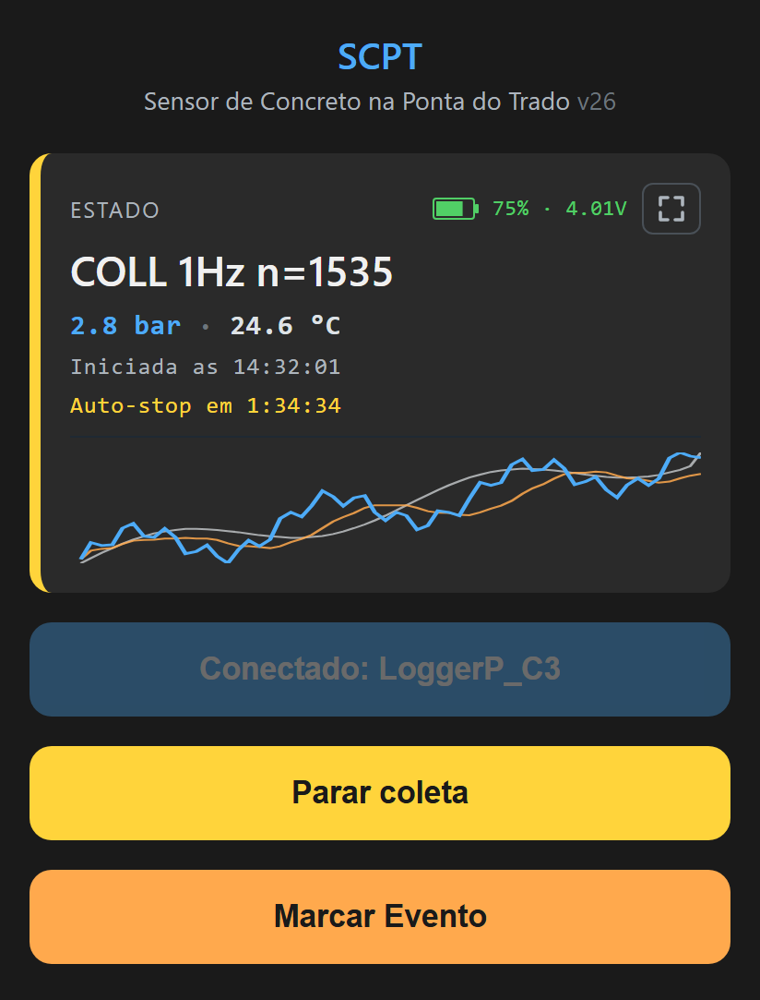

# Manual de Operação — Datalogger de Pressão Hidráulica

**Modelo:** LoggerP_C3\
**Hardware:** ESP32-C3 (Seeed XIAO) + sensor Keller PA9LD-50bar\
**Bateria:** LiPo 3,7 V 250 mAh recarregável

---

## 1. Visão geral

Este equipamento registra a **pressão hidráulica** medida pelo sensor Keller, gravando os valores em um arquivo CSV na memória interna. A coleta é feita a **1 Hz** (uma leitura por segundo); sempre que a pressão variar mais de **0,2 bar** entre duas leituras consecutivas, a taxa sobe automaticamente para **5 Hz** (uma leitura a cada 200 ms) e volta a 1 Hz após 30 segundos sem variação brusca.

A operação é feita pelo celular Android através do **app SCPT** — um aplicativo que abre pelo navegador Chrome e pode ser instalado no celular como um app comum, sem precisar da Play Store. Toda a interação (iniciar/parar coleta, baixar dados, ver gráfico) é feita pelo app via Bluetooth.

**O equipamento não tem botões nem LED de funcionamento.** Toda a interação é pelo celular.

---

## 2. O que você precisa

| Item | Detalhe |
|---|---|
| Celular Android | Bluetooth + Chrome/Edge. **iOS não tem suporte a Web Bluetooth no Safari.** |
| Cabo USB-C | Para carregar a bateria |
| Carregador USB | 5 V, qualquer fonte de celular padrão |

**App SCPT disponível em:**
https://marcelobatistabhz.github.io/SCPT-Sensor-de-Concreto-na-Ponta-do-Trado/

---

## 3. Instalando o app SCPT no celular (uma vez só)

1. No celular Android, abra o **Chrome**.
2. Acesse o link do app acima.
3. Toque no menu (⋮) → **"Instalar app"** ou **"Adicionar à tela inicial"**.
4. Confirme. O ícone do manômetro, com o nome **SCPT**, aparece no launcher.

A partir daqui, abrir o app SCPT é igual a abrir qualquer outro app. Funciona offline (exceto para receber atualizações de versão).

---

## 4. Carregamento da bateria

1. Conecte o cabo USB-C ao equipamento e a um carregador 5 V.
2. O **LED laranja** próximo ao conector USB acende durante a carga.
3. Quando o LED apaga, a bateria está cheia.
4. Tempo total de carga: **~1 h** com carregador de 500 mA ou maior.
5. Você pode usar o equipamento normalmente enquanto ele estiver conectado ao carregador.

> ⚠️ **Sempre verifique o nível de bateria no app antes de uma sessão longa.** O indicador no canto superior direito do card "Estado" mostra o percentual e a tensão.

---

## 5. Ligando o equipamento

O equipamento liga **assim que a bateria é conectada** ou assim que o cabo USB é plugado. Não há botão de power.

Para confirmar que está ligado: abra o app SCPT, toque em **"Conectar via Bluetooth"** e verifique se `LoggerP_C3` aparece na lista de dispositivos próximos.

---

## 6. Tela do app SCPT



**Topo:** o nome do app e, no fim do subtítulo, a **versão** (ex.: `v24`). Informe a versão ao relatar algum problema.

**Card "Estado"** (de cima para baixo):
- **Bateria**, no canto superior direito: percentual e tensão. Ao lado fica o botão de **números grandes**, que alterna para uma visão só com pressão e temperatura em fonte grande (para ler de longe).
- **Estado e contador de amostras**: por exemplo `COLL 1Hz n=1535` (coletando a 1 Hz, 1535 leituras gravadas).
- **Valores ao vivo**: pressão em bar (azul) e temperatura em °C.
- **"Iniciada às HH:MM:SS"**: horário do celular em que a coleta começou (só durante a coleta).
- **"Auto-stop em H:MM:SS"**: quanto falta para a parada automática de 2 horas.
- **Mini-gráfico dos últimos 60 s**: azul = pressão, laranja = média, cinza = temperatura.

**Abaixo do card** (durante a coleta a tela fica enxuta: só **Parar coleta** e **Marcar Evento**; os demais botões voltam ao parar):
- **Conectar via Bluetooth**: depois de conectado, mostra `Conectado: LoggerP_C3`.
- **Iniciar coleta** (verde): aparece fora da coleta. **Parar coleta** (amarelo): aparece só durante a coleta.
- **Marcar Evento** (laranja): só aparece durante a coleta (ver 7.4).
- **Baixar de novo** (azul): só aparece se o download automático do log falhar (ver 7.6). Para compartilhar uma coleta, use o **Historico** (ver 7.6 e 7.10).
- **Historico (N)**: lista recolhida com as últimas 20 coletas baixadas, guardadas no celular (ver 7.10).
- **Avançado**: menu recolhido com as funções menos usadas (apagar log, download via Wi-Fi etc.).

**Cores do card Estado:**
- 🔵 **Azul** = Pronto (READY) — log disponível para download
- 🟡 **Amarelo** = Coletando (COLL)
- 🟣 **Roxo** = Wi-Fi ligado para download (SERVING)
- 🟠 **Laranja pulsante** = Reconectando
- 🔴 **Vermelho** = Desconectado

**Indicador de bateria:**
- Verde (>50%): tudo bem
- Amarelo (20-50%): comece a se preocupar
- Vermelho (<20%): carregue logo

---

## 7. Operação — passo a passo

### 7.1 Conectar

1. Abra o app SCPT no celular.
2. Confirme **Bluetooth ligado** e **Localização ligada** (Android exige localização ativa para scan BLE — exigência do sistema).
3. Toque em **"Conectar via Bluetooth"**.
4. Escolha `LoggerP_C3` na lista que aparece.
5. Em ~2 s o card "Estado" muda de "Desconectado" para `IDLE` (ou `READY` se houver log de sessão anterior).

### 7.2 Iniciar coleta

Toque em **"Iniciar coleta"** (botão verde). O estado muda para `COLL 1Hz n=0` e o contador começa a subir em tempo real.

> ⚠️ A nova coleta **substitui o log anterior** no equipamento, e o gráfico da coleta anterior sai da tela do app. Se o log anterior foi baixado (o app baixa sozinho ao parar), ele continua no **Histórico** do celular (ver 7.10).

Aparecem também:
- **"Iniciada às HH:MM:SS"** — horário do celular em que você iniciou.
- **"Auto-stop em H:MM:SS"** — quanto tempo falta para o auto-stop de 2 horas.

Durante a coleta a tela fica só com **Parar coleta** e **Marcar Evento**. Iniciar coleta, Historico e Avançado somem e voltam quando a coleta para — inclusive se a conexão cair no meio ("Reconectando..."), a tela continua enxuta.

### 7.3 Durante a coleta

A taxa alterna automaticamente entre 1 Hz (regime estável) e 5 Hz (variações rápidas). Os dados são gravados em tempo real na flash interna.

**Comportamento de campo (trado descendo):** se o celular sair de alcance (equipamento desce abaixo da superfície), a conexão BLE cai e o app mostra "Reconectando...". O equipamento **continua coletando normalmente**. Quando voltar para perto, o app reconecta sozinho em até 4 s.

### 7.4 Marcar Evento (anotações na timeline)

Durante a coleta, aparece o botão **"Marcar Evento"** (laranja). Toque para abrir um modal com 5 opções fixas:

| Opção | Cor | Quando usar |
|---|---|---|
| Inicio perfuracao | Azul | Trado começou a descer |
| Fim perfuracao | Azul | Trado chegou à cota final |
| Inicio concretagem | Verde | Bomba começou a injetar concreto |
| Fim concretagem | Verde | Concretagem encerrada |
| Outra situacao | Cinza | Evento não previsto (anote depois no relatório) |

Toque na opção desejada → toast confirma "Marcado: ..." → o modal fecha.

**O que acontece:** a próxima amostra registrada no CSV vai ter o texto da anotação na **4ª coluna**. No gráfico final, aparece uma linha vertical tracejada na cor da categoria com o texto rotacionado ao lado.

**Atraso entre o toque e a gravação:** ≤ 1 segundo em 1 Hz, ≤ 200 ms em 5 Hz. Para registrar eventos com precisão fina, toque um pouco antes do momento exato.

**Quantas anotações pode fazer?** Quantas quiser. Cada uma é uma linha no CSV.

### 7.5 Parar coleta

Toque em **"Parar coleta"** (botão amarelo). Estado muda para `READY` e o app **baixa o log sozinho**: a barra de progresso enche em ~3-10 segundos via Bluetooth e o gráfico aparece logo abaixo (ver 7.7).

Alternativamente, a coleta para automaticamente:
- Após **2 horas** (limite máximo de sessão).
- Quando a bateria descarrega.

Se a coleta parar sozinha com o celular conectado, o download também é automático. Se o celular estava longe ou o app foi fechado, o app baixa o log assim que conectar de novo ao equipamento — **sem abrir o gráfico**: se for uma coleta que ainda não estava no celular, aparece o aviso **"Coleta do equipamento guardada no Historico"** e ela entra no Historico (ver 7.10), de onde se abre o gráfico. Se a coleta já estava no Historico, o download é silencioso (só a barra de progresso por alguns segundos).

### 7.6 Compartilhar o log

Depois que o log foi baixado (automático ao parar a coleta, ver 7.5), a coleta aparece na **primeira linha do Historico** (ver 7.10).

1. Toque em **"Historico"** para abrir a lista.
2. Na primeira linha (a coleta que acabou de terminar), toque no **ícone de compartilhar** (azul).
3. O **menu de compartilhamento do Android** abre: escolha **WhatsApp**, e-mail ou qualquer app para enviar o `log.csv`.

O nome do arquivo já vem com a data/hora do download: `log_2026-05-10_14-32-01.csv`.

**Se o download falhar** (Bluetooth caiu, equipamento longe), o app avisa e aparece o botão **"Baixar de novo"**. Aproxime o celular e toque nele. Se a conexão cair no meio do download, o app tenta de novo sozinho quando reconectar.

Se o app não conseguir guardar a coleta no Historico (por exemplo, celular sem espaço), aparece na tela inicial um botão **"Compartilhar"** para enviar essa última coleta.

### 7.7 Ver gráfico

Assim que o log é baixado (ao parar a coleta), o gráfico aparece abaixo dos botões. Mostra:

- **Linha azul:** pressão (bar) ao longo do tempo
- **Linha laranja:** média móvel das últimas 50 leituras (suaviza ruído, mostra tendência)
- **Linha cinza:** temperatura (°C, média dos últimos ~6 s — ver 8), eixo Y secundário à direita
- **Bolinha vermelha:** pico de pressão da sessão, com o valor numérico
- **Linhas verticais tracejadas coloridas:** anotações de "Marcar Evento" (ver 7.4) — azul para perfuração, verde para concretagem, cinza para outras
- **Info:** total de amostras, pico (com tempo), duração, contagem de anotações, pressão mínima e máxima, temperatura inicial→final com ΔT, e a legenda das linhas (pressão, média, temp)

**Gestos no gráfico:**
- **Pinça** com 2 dedos: zoom no eixo de tempo
- **Arrasta** com 1 dedo (depois de zoomar): mover dentro do range zoomado
- **Toque duplo:** voltar à visão completa

### 7.8 Apagar e iniciar nova sessão

Não é necessário apagar manualmente — toque em **"Iniciar coleta"** novamente e o equipamento substitui o log anterior. O gráfico e o log da coleta anterior também saem da tela do app.

Se quiser apagar sem iniciar nova sessão, expanda **"Avançado"** e toque em **"Apagar log atual"**.

### 7.9 Download via Wi-Fi (fallback)

Caso o BLE file transfer falhe (link instável, arquivo muito grande, etc.), há fallback via Wi-Fi:

1. Expanda **"Avançado"** no app.
2. Toque em **"Preparar download (Wi-Fi)"**. Estado muda para `WIFI 192.168.4.1`.
3. Saia do app (não feche), vá em **Wi-Fi** do celular.
4. Conecte na rede `LoggerP_AP` (sem senha). Aceite "manter conectado mesmo sem internet".
5. Volte no app e toque em **"Abrir log.csv"**.
6. O navegador baixa o arquivo. Compartilhe via menu do sistema do celular.

### 7.10 Histórico de coletas

O app guarda no celular as **últimas 20 coletas baixadas**. Toda coleta entra sozinha no histórico quando o log é baixado (ao parar a coleta ou pelo "Baixar de novo"); baixar a mesma coleta duas vezes não cria item repetido. Quando entra a 21ª, a mais antiga sai.

Toque em **"Historico (N)"** para abrir a lista. Cada coleta ocupa uma linha com a data/hora do download (a mesma do nome do arquivo), a duração e o pico de pressão — por exemplo `22/10 14:45 · 1h12m · 6.8 bar` — e dois ícones à direita:

- **Ícone de gráfico** (cinza): abre o gráfico daquela coleta, com a data no título.
- **Ícone de compartilhar** (azul, três pontos ligados): envia o `log.csv` daquela coleta (WhatsApp, e-mail etc.).

O histórico funciona **sem conexão** com o equipamento e sem internet.

> ⚠️ O histórico fica **dentro do app**. Desinstalar o app ou usar "Limpar dados" nas configurações do Android apaga o histórico. Compartilhe as coletas importantes.

---

## 8. Formato do arquivo `log.csv`

```
ms;bar;degC;note
0;0.0;25.4;
1000;0.0;25.4;
2000;0.0;25.5;inicio perfuracao
2200;0.5;25.5;
2400;0.7;25.5;
...
```

| Coluna | Conteúdo |
|---|---|
| `ms`   | Tempo em milissegundos desde o início da sessão (`Iniciar coleta`). |
| `bar`  | Pressão **manométrica** em bar (0 = atmosférica). 1 casa decimal. |
| `degC` | Temperatura do sensor em °C. 1 casa decimal. É a **média dos últimos ~6 s**, com um filtro que evita o vai-e-volta de ±0,1 °C; leva alguns segundos para acompanhar uma mudança brusca. |
| `note` | Texto da anotação (ver 7.4). Vazio em quase todas as linhas. |

Separador: **ponto e vírgula** (`;`). Casa decimal: **ponto** (`.`).
Compatível com Excel BR (Importar de Texto, separador `;`).

**Valores possíveis na coluna `note`:**

- (vazio) — amostra normal
- `inicio perfuracao`
- `fim perfuracao`
- `inicio concretagem`
- `fim concretagem`
- `outra`

**Observações importantes:**

- O timestamp é **relativo ao início da sessão**. O app mostra o horário do celular em que a sessão começou; some `ms / 1000` segundos a esse horário para datar leituras específicas.
- Em modo 1 Hz, o intervalo entre linhas é ~1000 ms. Em modo 5 Hz, ~200 ms. A transição é visível no espaçamento dos timestamps.
- O sensor está configurado em **modo gauge** — em pressão atmosférica a leitura fica próxima de 0 (com pequeno ruído residual de ~±0,1 bar, dentro da precisão do sensor).
- A anotação fica atrelada à **próxima amostra após o toque** no botão "Marcar Evento", então pode haver até 1 segundo de defasagem em modo 1 Hz.

---

## 9. Cuidados e limites

| Item | Especificação |
|---|---|
| Faixa de pressão | 0 a 50 bar |
| Resolução de tempo | 1 ms (gravação), exatidão ~±10 ms |
| Tempo máximo de sessão | 2 horas |
| Tempo máximo cumulativo em modo 5 Hz | 30 min por sessão |
| Capacidade do arquivo | ~250 KB (suficiente para a sessão máxima) |
| Temperatura de operação | Conforme datasheet do sensor Keller |
| Resistência à água | **Não submergir o ESP32-C3.** Apenas a ponta do sensor é estanque. |

---

## 10. Solução de problemas

| Sintoma | Possível causa | O que fazer |
|---|---|---|
| `LoggerP_C3` não aparece ao tocar "Conectar" | Equipamento desligado, fora de alcance, ou Bluetooth/Localização desligados | Confirme bateria, aproxime do celular, ative BT e Localização |
| Conecta mas estado fica em "Reconectando..." | Distância no limite, ou ruído | Aproxime mais. O app tenta reconectar automaticamente |
| Estado fica em `COLL 1Hz n=0` sem incrementar | Sensor não respondeu | Conecte ao USB, abra Serial monitor (Arduino IDE) pra ver `[AVISO]` no boot |
| Download trava na barra de progresso | Link BLE instável | Aguarde 15 s: o app avisa e mostra **"Baixar de novo"**. Aproxime o celular e toque nele; se continuar falhando, use a opção Wi-Fi (Avançado) |
| Wi-Fi `LoggerP_AP` não aparece após DOWNLOAD | Alguns Androids escondem redes abertas | Adicionar rede manualmente no celular: `LoggerP_AP`, sem senha |
| Indicador de bateria sumiu | Pode ser desconexão recente | Aguarde uns segundos; aparece novamente quando o status atualiza |
| Após queda de energia, aparece `READY` no boot | Sessão anterior interrompida | Os dados gravados estão preservados. Ao conectar, o app baixa o log sozinho; compartilhe antes de um novo "Iniciar coleta" |
| Equipamento parou de gravar antes de 2 h | Bateria acabou | Recarregue. Os dados gravados estão preservados |
| Histórico sumiu ou ficou vazio | App desinstalado, ou dados do app limpos nas configurações do Android | Não há como recuperar no celular. As coletas compartilhadas continuam onde foram enviadas, e a última coleta continua no equipamento até o próximo "Iniciar coleta" |

### Forçar reset do equipamento

Não há botão de reset acessível externamente. Para forçar reinicialização:

1. Desconecte a bateria por ~5 segundos (se tiver acesso) **ou**
2. Conecte ao cabo USB e pressione o botão `RESET` da placa XIAO.

---

## 11. Especificações resumidas

| | |
|---|---|
| **Microcontrolador** | Espressif ESP32-C3 (Seeed XIAO) |
| **Sensor de pressão** | Keller PA9LD-50bar (I²C, 0–50 bar, modo gauge) |
| **Bateria** | LiPo 3,7 V 250 mAh, recarga via USB-C |
| **Monitoramento de bateria** | ADC interno via divisor 1:2 (mod) |
| **Conectividade** | Bluetooth Low Energy 4.x (legacy advertising) + Wi-Fi 2,4 GHz |
| **Memória de log** | ~1,5 MB (LittleFS na flash interna) |
| **Taxa de amostragem** | 1 Hz padrão, 5 Hz adaptativo (ΔP > 0,2 bar) |
| **Duração máxima de sessão** | 2 horas |
| **Formato de saída** | CSV (`ms;bar;degC;note`) |
| **Identificador BLE** | `LoggerP_C3` |
| **SSID Wi-Fi para download** | `LoggerP_AP` (rede aberta) |
| **App SCPT** | https://marcelobatistabhz.github.io/SCPT-Sensor-de-Concreto-na-Ponta-do-Trado/ |

---

## 12. Operação alternativa via nRF Connect (debug)

Se o app SCPT estiver indisponível ou para depuração, o equipamento pode ser operado pelo app **nRF Connect for Mobile** (Nordic Semiconductor, gratuito).

**UUIDs:**
- **Serviço:** `9b78c001-c0de-4d65-a1aa-001122334455`
- **Comando** (write): `9b78c002-c0de-4d65-a1aa-001122334455`
- **Status** (read+notify): `9b78c003-c0de-4d65-a1aa-001122334455`
- **Data** (notify, transferência do CSV): `9b78c004-c0de-4d65-a1aa-001122334455`

**Comandos** (texto UTF-8 escrito na char Comando):

| Comando | Função |
|---|---|
| `START` | Inicia coleta (apaga log anterior) |
| `STOP` | Para coleta |
| `TARE` | Calibra offset do sensor (em IDLE ou READY) |
| `READ` | Inicia transferência do CSV pela char Data |
| `NOTE n` | Anotação na timeline (n=1..5, só em COLLECT). Texto vai pra coluna `note` da próxima amostra. |
| `DOWNLOAD` | Liga AP Wi-Fi |
| `STOPWIFI` | Desliga AP Wi-Fi |
| `ERASE` | Apaga log atual |

**Tabela de `NOTE n`:**

| `n` | Texto gravado |
|---|---|
| `1` | `inicio perfuracao` |
| `2` | `fim perfuracao` |
| `3` | `inicio concretagem` |
| `4` | `fim concretagem` |
| `5` | `outra` |

**Formato do status** (lido/notificado pela char Status):

```
IDLE b=4050
COLL 1Hz n=42 r=7158 b=4015
READY n=14400 b=3920
WIFI 192.168.4.1 b=3895
```

- `b=NNNN` = tensão da bateria em mV (sempre presente)
- `r=NNN` = segundos restantes até auto-stop (apenas em COLL)

---

*Última revisão: 2026-10-22*
